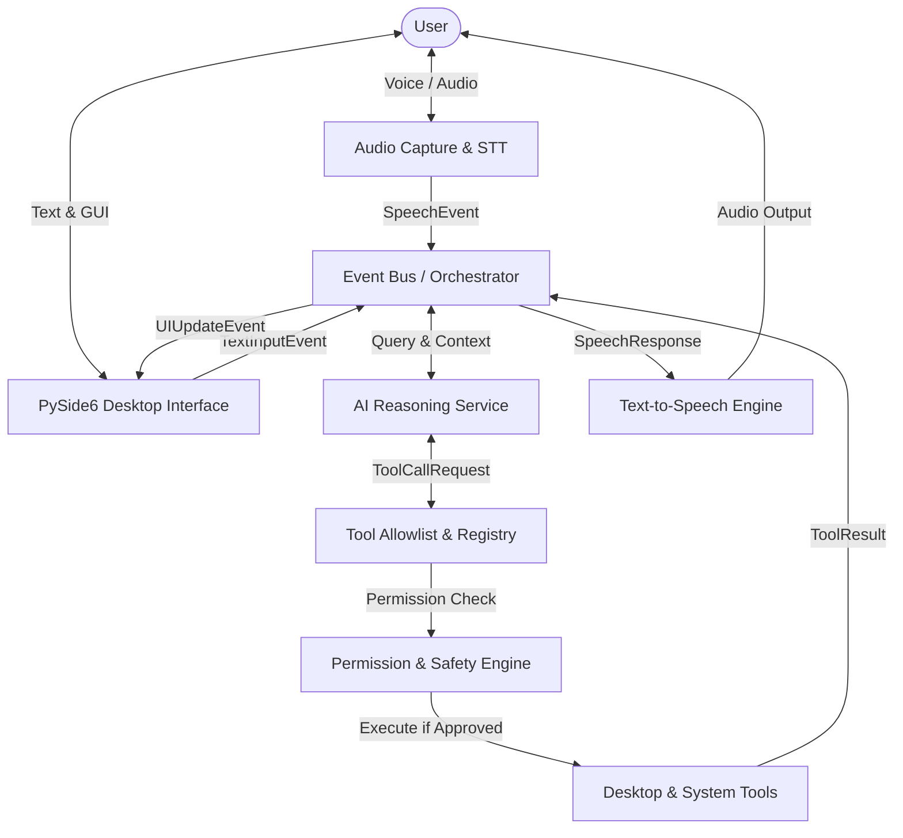

# EAGLE Architecture & System Design

## 1. Overview

**EAGLE** (Enhanced Autonomous General-purpose Local Executive) is designed as a modular, decoupled desktop voice assistant. It follows strict separation of concerns across audio input/output, AI reasoning, desktop automation, and user interface.



---

## 2. Subsystem Directory Structure

```text
EAGLE/
├── AGENTS.md                  # Persistent instructions for AI agents
├── README.md                  # Project overview, installation, and usage
├── CHANGELOG.md               # Versioned change history
├── pyproject.toml             # Build, linting, formatting, and test settings
├── requirements.txt           # Production dependencies
├── requirements-dev.txt       # Development & testing dependencies
├── .env.example               # Template for optional API keys
├── .gitignore                 # Strict rules to prevent secret/artifact leakage
│
├── docs/                      # Comprehensive technical documentation
│   ├── ARCHITECTURE.md        # This document
│   ├── SETUP.md               # Setup and environment walkthrough
│   ├── DEVELOPMENT.md         # Developer guide, style guide, and test conventions
│   ├── SECURITY.md            # Threat model, safety rules, permission system
│   ├── FEATURE_STATUS.md      # Truthful matrix of features and statuses
│   ├── DECISIONS.md           # Architecture Decision Records (ADRs)
│   ├── TASK_LOG.md            # Development task logs with commit SHAs
│   └── IMPLEMENTATION_PLAN.md # Milestone tracker
│
├── eagle/                     # Main application package
│   ├── __init__.py
│   ├── main.py                # Entry point
│   │
│   ├── core/                  # Core infrastructure
│   │   ├── __init__.py
│   │   ├── config.py          # Pydantic configuration model and loader
│   │   ├── logging.py         # Structured logging with secret redaction
│   │   ├── exceptions.py      # Custom exception hierarchy
│   │   └── events.py          # Decoupled publish/subscribe event bus
│   │
│   ├── services/              # External interfaces and service clients
│   │   ├── __init__.py
│   │   ├── audio_capture.py   # Microphone listener and VAD
│   │   ├── stt.py             # Speech-to-Text abstraction
│   │   ├── tts.py             # Text-to-Speech abstraction
│   │   ├── wake_word.py       # Wake word engine
│   │   └── ai_provider.py     # Pluggable AI reasoning providers
│   │
│   ├── tools/                 # Safe system automation tools
│   │   ├── __init__.py
│   │   ├── base.py            # BaseTool abstraction and schemas
│   │   ├── registry.py        # Tool registry and allowlist enforcement
│   │   ├── apps.py            # Application launcher
│   │   ├── web.py             # Web browsing and search
│   │   ├── files.py           # Sandboxed file operations
│   │   └── system.py          # Safe system telemetry
│   │
│   └── ui/                    # PySide6 desktop user interface
│       ├── __init__.py
│       ├── main_window.py     # Main application window
│       ├── widgets/           # Visualizer, transcript, status cards
│       ├── styles/            # QSS / dark eagle styling
│       └── dialogs/           # Permission confirmations, settings
│
└── tests/                     # Automated test suite
    ├── __init__.py
    ├── conftest.py            # Pytest fixtures and mocks
    ├── unit/                  # Fast, offline unit tests
    └── integration/           # Real component interaction tests
```

---

## 3. Core Subsystems & Responsibilities

### 3.1 `eagle.core.config`
- Single source of truth for all runtime settings.
- Uses Pydantic v2 for data validation and schema coercion.
- Loads from `config.json` with fallback to safe defaults.
- Validates filesystem directory paths, allowed applications, and audio settings.

### 3.2 `eagle.core.logging`
- Formats logs into human-readable console output and structured disk logs.
- Includes a token/key sanitizer filter to prevent API keys or secrets from leaking to disk or standard output.

### 3.3 `eagle.core.exceptions`
- Hierarchy:
  - `EagleError` (Root)
    - `ConfigurationError`
    - `AudioError` (e.g. `MicrophoneNotFoundError`, `TranscriptionError`, `SpeechSynthesisError`)
    - `AIProviderError` (e.g. `ModelUnavailableError`, `RateLimitError`)
    - `ToolError` (e.g. `ToolNotFoundError`, `ToolExecutionError`, `PermissionDeniedError`, `SecurityViolationError`)

### 3.4 `eagle.core.events`
- Event-driven communication decouples UI, audio processing, and AI execution.
- Prevents tight coupling or circular imports between services.

### 3.5 `eagle.tools`
- Every tool inherits from `BaseTool` with typed Pydantic parameters schema and structured `ToolResult`.
- The `ToolRegistry` enforces an allowlist: only explicitly registered tools can ever be executed.
- Sensitive tools require an explicit confirmation token or approval callback before execution.
- **`LaunchAppTool` (`eagle/tools/apps.py`)**:
  - Validates requested application against `SecurityConfig.allowed_applications`.
  - Rejects path traversal sequences and untrusted executable path overrides.
  - Spawns subprocesses detached using argument arrays (`[executable]`), never raw shell strings (`shell=False`).
- **`OpenWebsiteTool` (`eagle/tools/web.py`)**:
  - Enforces HTTP/HTTPS protocol validation, blocking dangerous schemes (`file:`, `javascript:`, `data:`, `ftp:`).
  - Sanitizes hostnames, blocks embedded user/password credentials, and opens URLs in the operating system default browser.
- **`WebSearchTool` (`eagle/tools/web.py`)**:
  - Formats natural language web queries across configurable search providers (Google, DuckDuckGo, Bing).
  - Inspects queries to prevent accidental leakage of local file paths, API keys, bearer tokens, or secrets.
- **`ListFilesTool` (`eagle/tools/files.py`)**:
  - Sandboxed directory reader restricted strictly to `SecurityConfig.allowed_directories`.
  - Blocks `..` traversal and symlink escapes using canonical path resolution (`Path.resolve()`).
  - Returns structured, human-readable directory listings with file sizes, timestamps, and entry limits.
- **`InspectFileTool` (`eagle/tools/files.py`)**:
  - Inspects file metadata (size, created, modified, type, symlink status) within allowed boundaries.
  - Non-destructive and strictly read-only; does not modify files or read arbitrary file contents.
- **`SystemInfoTool` (`eagle/tools/system.py`)**:
  - Reads non-invasive telemetry metrics: operating system platform, CPU utilization and cores, RAM usage, and battery level via `psutil`.
  - Supports topic-based filtering (`battery`, `cpu`, `memory`, `platform`, `all`). Gracefully handles unavailable sensors.

### 3.6 `eagle.services`
- **Audio Capture (`audio_capture.py`)**: Safely enumerates microphones via `sounddevice`, captures mono 16-bit PCM streams, calculates RMS amplitude for UI audio visualizers, and packages data into WAV containers.
- **Speech-to-Text (`stt.py`)**: Abstract `BaseSTTEngine` with implementations for local `FasterWhisperSTT` and offline deterministic `MockSTTEngine`.
- **Text-to-Speech (`tts.py`)**: Abstract `BaseTTSEngine` providing Windows SAPI5 voice output via `Pyttsx3TTSEngine` with immediate `stop()` speech interruption support and offline `MockTTSEngine`.
- **Command Router (`command_router.py`)**: Normalizes input speech/text, extracts conversational fillers, classifies intents (`SYSTEM_CONTROL`, `APP_LAUNCH`, `WEB_SEARCH`, `WEB_OPEN`, `SYSTEM_INFO`, `FILE_OPERATION`, `CONVERSATION`), and dispatches events via the `EventBus`.

### 3.7 `eagle.services.ai_provider`
- **AI Provider Abstraction (`BaseAIProvider`)**: Clean pluggable interface defining `generate_response(messages, tools)` and `is_available()`.
- **Mock Provider (`MockAIProvider`)**: Deterministic, offline reasoning engine for unit testing, test suites, and CI environments without network access or API fees.
- **OpenAI-Compatible Client (`OpenAICompatibleProvider`)**: Universal REST client supporting OpenAI, Groq, local Ollama, and OpenAI-compatible endpoints with configurable timeouts, retries, and comprehensive HTTP/network error mapping.
- **Conversation Context Management (`ConversationManager`)**: Sliding-window context manager enforcing configurable `max_conversation_turns` while permanently preserving the baseline system persona prompt.
- **AI Orchestrator (`AIOrchestrator`)**:
  - Dynamically extracts tool schemas from `ToolRegistry` and presents them as standard function definitions.
  - Coordinates multi-turn tool loops up to `max_tool_iterations` per turn.
  - Emits `ToolExecutionRequestedEvent`, executes actions safely via `ToolRegistry`, appends structured `role="tool"` results, and summarizes outcomes to the user.
  - Catches provider errors (`AuthenticationError`, `NetworkTimeoutError`, `RateLimitExceededError`, `ModelUnavailableError`) and emits clear, user-friendly spoken feedback.


---

## 4. Concurrency & Threading Model

- **Main Thread**: Runs the PySide6 Qt event loop, rendering UI widgets and responding to user gestures.
- **Audio Worker Thread**: Captures microphone chunks via `sounddevice`, performs Voice Activity Detection (VAD), and triggers STT.
- **Orchestrator Worker Thread**: Handles async network requests to AI providers and invokes approved tools, emitting updates back to the UI via Qt Signals / Thread-safe EventBus.
