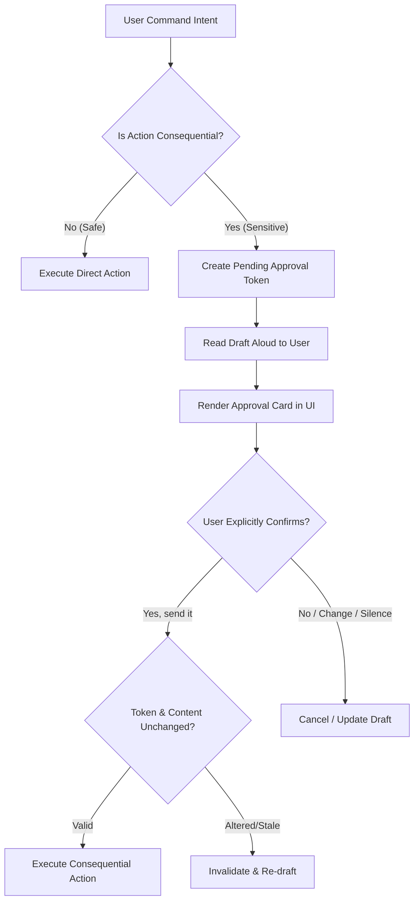
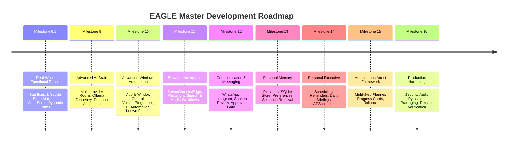

# PROJECT EAGLE 🦅
# MASTER TECHNICAL ARCHITECTURE & DEVELOPMENT ROADMAP
## Vision, Target Architecture, Subsystem Specifications, and Execution Strategy for Windows 11

> **Document Status**: Active Master Architectural Blueprint & Source of Truth  
> **Target Version**: v1.0.0 (Current: v0.8.0 / Commit `8cee252`)  
> **Platform**: Microsoft Windows 11 (64-bit AMD64)  
> **Runtime Environment**: Python 3.13.1 isolated virtual environment (`.venv/`)  
> **Repository Location**: `E:\Desktop\anti gravity projects\EAGLE`  
> **Author**: Chief Software Architect & AI Engineering Team  

---

## 1. Executive Summary & Vision

**EAGLE** (Enhanced Autonomous General-purpose Local Executive) is an intelligent, offline-first personal AI companion and autonomous desktop executive for Windows 11. EAGLE operates as a dependable friend, mentor, instructor, and personal executive capable of understanding natural human language, maintaining conversation context, controlling authorized Windows subsystems, automating browsers, managing communication drafts with strict human-in-the-loop approvals, retaining persistent personal memory, and organizing daily routines.

### Core Architectural Principles:
1. **Offline-First AI Operating Philosophy**: Local AI inference (Ollama / Qwen2.5 / Llama3.2) is the primary reasoning engine. Cloud AI (Gemini, Groq, OpenAI) is strictly optional, explicitly requested, and hard-blocked in offline mode (`OfflinePolicyViolationError`).
2. **Execute Directly Safe Actions; Require Approval for Consequential Actions**: Routine reversible actions (opening applications, opening websites, searching the web, taking screenshots, inspecting directories, reading system metrics, drafting messages) execute immediately without friction. Consequential, irreversible actions (sending messages, deleting files, purchases, external communications) enforce immutable, human-in-the-loop explicit verbal or GUI approval.
3. **Deterministic Interaction Lifecycle**: Complete adherence to the startup, greeting, sleeping, wake-word activation, task verification, and return-to-sleep state machine specified in Section 5 of the Master Prompt.
4. **Dynamic Path & System Awareness**: Dynamic Windows Known Folder resolution (`E:\Desktop`, `E:\Documents`, `E:\Downloads`) via Windows Registry and Shell APIs without hardcoded drive letters or static username assumptions.
5. **Architectural Decoupling**: Thread-safe EventBus publish-subscribe messaging, offloading heavy compute and blocking I/O to background workers, and marshaling UI updates to PySide6 via `EventBusQtBridge`.

---

## 2. Verified Repository State & Hardware Audit

A comprehensive inspection of the physical repository at `E:\Desktop\anti gravity projects\EAGLE` reveals the following verified baseline:

### 2.1 Repository & Environment Metrics
- **Git Branch**: `main` (synchronized with `origin/main` at commit `8cee252`).
- **Python Version**: Python 3.13.1 (64-bit AMD64).
- **Active Packages in `.venv`**: PySide6 6.12.0, pyttsx3 2.99, sounddevice 0.5.6, psutil 7.2.2, requests 2.34.2, pydantic 2.14.1, pyinstaller 6.22.3, pytest 9.1.1, ruff 0.17.1, mypy 2.4.0.
- **Existing Automated Test Suite**: **150 passed tests** across 17 test modules running in ~3.8 seconds with 100% pass rate.
- **Static Analysis Status**: Ruff lint clean (0 errors), Mypy static typing clean (0 errors across 32 source files).

### 2.2 Relocated Desktop Audit Findings
- **Relocation Background**: Windows Desktop and user shell folders were moved by the user from `C:\` to `E:\`.
- **`C:\Desktop` Inspection**:
  - Contains only `C:\Desktop\anti gravity projects\EAGLE\.keep` (0 bytes, created during initial probe).
  - No unique files, project data, user documents, or backups exist on `C:`.
  - Is a standard directory, not a junction or symbolic link.
  - Per explicit user directive, **no files were deleted and all files are preserved**.
- **`E:\Desktop` Active Project**:
  - Full git repository with `.git/`, source code (`eagle/`), test suite (`tests/`), documentation (`docs/`), and packaging specifications (`eagle.spec`).
  - Active Windows Registry (`HKCU\Software\Microsoft\Windows\CurrentVersion\Explorer\User Shell Folders`):
    - `Desktop` = `E:\Desktop`
    - `Personal` (Documents) = `E:\Documents`
    - `{374DE290-123F-4565-9164-39C4925E467B}` (Downloads) = `E:\Downloads`
  - Dynamic resolution implemented in `eagle/core/paths.py` via `get_desktop_dir()`, `get_documents_dir()`, and `get_downloads_dir()`.

### 2.3 Existing Functional Capabilities (Milestones 0–8)
1. **Core Infrastructure**: Pydantic v2 configuration (`EagleConfig`), structured logging with secret masking, thread-safe EventBus (`EventBus`).
2. **Audio Capture**: Non-blocking audio capture via `sounddevice.RawInputStream` (16kHz, 16-bit mono PCM). 30 physical audio devices detected on host.
3. **Speech Synthesis**: Windows SAPI5 TTS engine (`pyttsx3`) with 2 native voices (David and Zira), volume/rate controls, and barge-in speech interruption.
4. **Speech Recognition (STT)**: Faster-Whisper wrapper with model cache discovery and MockSTTEngine.
5. **Wake Word Detection**: Modular wake-word engine with MockWakeWord, openWakeWord ONNX wrapper, and sliding-window STT fallback.
6. **Command Routing**: Regex-based intent classification (`CommandRouter`) routing basic app, web, file, and system intents.
7. **Allowlisted Tools**: Process launcher (`LaunchAppTool`), browser opener (`OpenWebsiteTool`), search tool (`WebSearchTool`), directory inspector (`ListFilesTool`), file metadata inspector (`InspectFileTool`), and hardware telemetry (`SystemInfoTool`).
8. **Offline AI Provider**: Local `OllamaProvider` connecting to `http://localhost:11434`, OpenAI-compatible provider, and MockAIProvider.
9. **Desktop GUI**: PySide6 dark-themed interface (`MainWindow`), 32-bar audio visualizer (`visualizer.py`), status sidebar (`status_panel.py`), conversation feed (`conversation.py`), input bar (`input_bar.py`), and settings modal (`settings_dialog.py`).
10. **Packaging**: PyInstaller onedir specification (`eagle.spec`) producing `dist/EAGLE/EAGLE.exe`.

---

## 3. Existing Defects & Identified Technical Debt

| ID | Component | Defect Description | Impact | Target Fix Milestone |
| :--- | :--- | :--- | :--- | :--- |
| **DEF-01** | `eagle.core.config` | `AIConfig.provider` defaults to `"mock"` instead of attempting local Ollama discovery. | Users receive static canned mock responses out-of-the-box instead of genuine reasoning. | **Milestone 8.1** |
| **DEF-02** | `eagle.ui.conversation` | `ConversationFeedWidget._append_widget` calls `setValue(maximum())` before Qt layout calculation finishes. | Chat feed fails to scroll down automatically when new assistant or user messages arrive. | **Milestone 8.1** |
| **DEF-03** | `eagle.main` | `main()` checks `config.voice.wake_word_enabled` at line 177 and `config.audio.wake_word_enabled` at line 226. | Wake-word listener started twice in GUI mode or fails if disabled in voice config. | **Milestone 8.1** |
| **DEF-04** | `eagle.services.listener` | Missing exact interaction lifecycle (time-based greeting, sleeping state, "Yes boss! How can I help you?", "Boss! Is there anything I can help you with?", 5s timeout window). | Voice flow does not match user-specified companion executive lifecycle. | **Milestone 8.1** |
| **DEF-05** | `eagle.services.listener` | Microphone privacy during sleeping mode does not enforce discarding non-wake audio buffers. | Privacy ambiguity regarding continuous audio streaming. | **Milestone 8.1** |
| **DEF-06** | `eagle.tools.apps` / `command_router` | Command `"open downloads"` or `"open desktop"` gets classified as `LaunchAppTool` looking for `downloads.exe`. | Fails to open user Known Folders in Windows Explorer. | **Milestone 8.1 / 10** |
| **DEF-07** | `docs/BUILD_GUIDE.md` | Hardcoded `file:///c:/Desktop...` URL. | Broken link in documentation. | **Fixed (Milestone 8.1)** |
| **DEF-08** | `eagle.core.paths` | Hardcoded `C:/Program Files/Ollama` paths. | Fails detection on non-C system drives. | **Fixed (Milestone 8.1)** |

---

## 4. Missing Subsystems & Capabilities Gap Analysis

To fulfill the complete vision in the Unified Master Prompt, the following major subsystems must be designed and implemented:

```mermaid
graph TD
    User([User Voice / Text]) <--> GUI[PySide6 Desktop GUI]
    User <--> Mic[Microphone / Wake-Word]
    
    subgraph Core Executive Engine
        Listener[Continuous Listener & Lifecycle State Machine]
        Brain[Advanced AI Brain & Orchestrator]
        Perm[Permission & Approval Manager]
    end
    
    subgraph Intelligence Subsystems
        Memory[Personal Memory Subsystem (SQLite/Vector)]
        Planner[Multi-Step Autonomous Task Planner]
        Executive[Personal Executive & Reminders Scheduler]
        Comms[Messaging & Call Assistant]
        Browser[Browser Automation Layer (Playwright)]
        WinAuto[Windows UI Automation & System Control]
    end
    
    Mic --> Listener
    Listener <--> Brain
    GUI <--> Brain
    Brain --> Planner
    Planner --> Perm
    Perm --> WinAuto
    Perm --> Browser
    Perm --> Comms
    Brain <--> Memory
    Brain <--> Executive
```

1. **Windows Interaction Lifecycle Engine (Section 5)**:
   - Registry-based Windows startup integration (`HKCU\Software\Microsoft\Windows\CurrentVersion\Run`).
   - Time-based greeting generator with single-session deduplication.
   - SLEEPING vs ACTIVE dual-tier state machine.
   - Exact spoken vocal prompts and 5-second follow-up response window.
2. **Advanced AI Brain & Multi-Provider Router (Section 4.1, 7, 15)**:
   - Dynamic model discovery and health checks for Ollama (`qwen2.5:3b`, `llama3.2:3b`, `deepseek-r1`).
   - Structured persona system (friendly companion, executive assistant, technical mentor, patient instructor).
   - Multi-turn conversation context pruning and task-aware provider routing.
   - Fallback error recovery without silent failure or fake mock responses.
3. **Advanced Windows Automation Subsystem (Section 8)**:
   - Window management: detect, switch, minimize, maximize, snap, and close applications via native Win32 APIs (`pywin32` / `ctypes`).
   - UI Automation: element inspection, semantic clicking, dialog handling via Microsoft UI Automation (`pywinauto` / `comtypes`).
   - Filesystem operations: folder creation, file copy/move/rename, folder organization, known-folder resolution.
   - System control: volume adjustment and mute (`pycaw`), screen brightness (`wmi`), desktop screenshots (`mss` / Pillow), battery and CPU telemetry.
4. **Browser Intelligence Layer (Section 11)**:
   - Multi-browser integration for Brave, Google Chrome, and Microsoft Edge.
   - Playwright-powered persistent browser automation supporting user profile sessions.
   - Autonomous web navigation, multi-tab management, form filling, and media playback control (e.g. streaming services) with state verification.
5. **Messaging & Approval Workflow Engine (Section 9)**:
   - Platform integration adapters for WhatsApp and Instagram.
   - Contact resolution and conversation targeting.
   - Multi-stage message preparation: draft generation, spoken read-aloud review, verbal corrections loop.
   - Cryptographically bound, immutable approval workflow requiring explicit approval before sending.
6. **Intelligent Call Assistant Subsystem (Section 10)**:
   - Call detection interface via Windows Phone Link / WhatsApp Desktop notifications.
   - Configurable response timeout (60–80s ring monitoring).
   - Automated answering with mandatory AI identity disclosure ("Hello! I am EAGLE, the personal AI assistant...").
   - Spoken message collection, transcription, and callback task creation.
7. **Personal Memory Subsystem (Section 12)**:
   - SQLite-backed relational and vector memory store (`%APPDATA%/EAGLE/memory.db`).
   - Categories: User Preferences, Contacts & Relationships, Daily Routines, Projects, Conversation History.
   - Natural language memory retrieval, semantic search, user correction, inspection, and deletion controls.
8. **Personal Executive & Scheduling Subsystem (Section 13)**:
   - Background persistent scheduler (`APScheduler`) surviving application restarts.
   - Natural language scheduling parser ("remind me tomorrow at 10 AM").
   - Spoken notification alarms and daily executive morning briefings.
9. **Autonomous Multi-Step Agent Execution Framework (Section 14)**:
   - Plan-Act-Verify execution graph.
   - Step-by-step progress tracking with real-time UI card updates.
   - Safe cancellation, rollback mechanisms, and post-task result verification.

---

## 5. Technical Research & Feasibility Analysis

### 5.1 Local AI Inference (Ollama)
- **Feasibility**: High.
- **Architecture**: Ollama exposes an HTTP REST API at `http://localhost:11434`. It natively supports OpenAI-compatible endpoints (`/v1/chat/completions`) with tool calling (`tools` parameter) and JSON schema validation.
- **Recommended Models**:
  - `qwen2.5:3b`: Exceptional instruction-following, structured JSON output, low RAM footprint (~2.1 GB VRAM / RAM).
  - `llama3.2:3b`: Fast conversational responses, strong multi-turn reasoning.
- **Windows Integration**: Detected via Windows Registry and standard executable paths (`%LOCALAPPDATA%\Programs\Ollama\ollama.exe`, `%ProgramFiles%\Ollama\ollama.exe`).

### 5.2 Speech Recognition & Wake-Word
- **Feasibility**: High.
- **STT**: `faster-whisper` (CTranslate2) provides fast offline transcription (~150ms on modern CPU/GPU). For environments where CTranslate2 prebuilt wheels require compilation, Windows SAPI Speech Recognition (`win32com.client`) or sliding-window energy STT provides zero-dependency offline fallback.
- **Wake Word**: `openwakeword` ONNX models run locally with ~1-2% CPU utilization. Sliding-window acoustic STT provides fallback when ONNX runtime is unavailable.
- **Privacy Enforcement**: In SLEEPING mode, audio buffer length is constrained to 1.5 seconds, processed strictly in-memory by the wake-word detector, and discarded immediately if no wake phrase matches.

### 5.3 Windows UI Automation & System Control
- **Feasibility**: High.
- **Window & Process Management**: Native Win32 API (`win32gui`, `win32process`, `win32con`) allows enumerating top-level windows, retrieving process IDs, focusing windows (`SetForegroundWindow`), minimizing/maximizing (`ShowWindow`), and closing windows (`WM_CLOSE`).
- **Semantic UI Automation**: Microsoft Windows UI Automation (UIA) via `pywinauto` or `comtypes` provides accessibility tree inspection, button clicking, edit box text insertion, and window state monitoring without brittle coordinate-based clicking.
- **Volume & Brightness**: Windows Core Audio API (`pycaw`) enables exact master volume adjustment (0-100%) and mute toggling. WMI / Win32 API (`GetMonitorBrightness`) adjusts display brightness where hardware supports it.
- **Known Folders**: Windows Registry `HKCU\Software\Microsoft\Windows\CurrentVersion\Explorer\User Shell Folders` dynamically resolves relocated Desktop, Documents, and Downloads.

### 5.4 Browser Automation (Playwright)
- **Feasibility**: High.
- **Playwright Python**: Supports launching and connecting to Chromium, Brave, and Edge via Chrome DevTools Protocol (CDP) or persistent user data directories.
- **Streaming Workflows**: Playwright can navigate to media services, interact with search bars, click matching video thumbnails, and query HTML5 `<video>` tags (`document.querySelector('video').paused`) to verify playback state.
- **DRM & Subscription Integrity**: EAGLE will never bypass DRM, paywalls, or authentication. Persistent browser contexts allow using existing logged-in sessions.

### 5.5 Messaging & Approval Workflow
- **WhatsApp Desktop / Web**: WhatsApp Web or Desktop can be controlled via Playwright or UI Automation to search contacts, draft messages into the chat input, and inspect delivery status ticks.
- **Instagram Direct**: Instagram Web messaging via Playwright allows navigating to `instagram.com/direct/t/...`, typing drafts, and sending upon approval.
- **Approval Gate**: Before invoking `click_send()` or pressing `Enter`, an immutable `PendingApproval` token is generated. The assistant speaks the draft aloud, displays the draft card in the UI, and requires explicit user confirmation ("Yes, send it") matching the exact recipient and text.

### 5.6 Call Management Subsystem
- **Feasibility**: Medium (Platform Dependent).
- **Telephone Calls**: Native cellular calls on Windows 11 are managed through **Windows Phone Link**. Phone Link exposes UI Automation elements and toast notifications for incoming calls. Automated audio streaming (answering and speaking into a cellular call) requires virtual audio cables (`VB-CABLE`) or Phone Link audio routing.
- **WhatsApp VoIP Calls**: WhatsApp Desktop displays an incoming call popup. UI Automation can detect the popup window and caller name.
- **Honest Platform Boundaries**: If automated audio routing is not supported by the hardware/driver setup, EAGLE will announce the caller ("Boss, incoming call from John Doe on WhatsApp"), monitor the 60-80s timeout, and notify the user to take a message or schedule a callback, rather than fabricating full call interception.

---

## 6. Security and Privacy Architecture



### 6.1 Strict Tool Allowlisting & Path Containment
- All automation tools inherit from `BaseTool` with Pydantic v2 schemas validating every parameter.
- Filesystem access is strictly restricted to dynamically resolved `allowed_directories` (`E:\Documents`, `E:\Desktop`, `E:\Downloads`, project directory). Any path traversal (`../`) or escaping is blocked with `SecurityViolationError`.
- No arbitrary shell execution (`shell=False`, prohibited `cmd.exe /c` or PowerShell raw execution).

### 6.2 Approval Workflow Security
- Consequential tools (`send_message`, `delete_file`, `system_power`, `external_call`) are flagged with `is_sensitive = True`.
- `ApprovalManager` generates a unique SHA-256 bound token `hash(recipient + content + platform + timestamp)`.
- If the user modifies any word of the message, the previous token is invalidated immediately.
- Silence or ambiguous responses are strictly treated as rejection.

### 6.3 Local Audio Privacy Boundary
- Wake-word detection operates entirely on local audio frames.
- Non-wake audio frames during SLEEPING mode are discarded after 1.5 seconds.
- In privacy mode (hardware/software mute switch), the microphone stream is physically disconnected (`audio_capture.stop_recording()`).

---

## 7. Master Milestone Development Roadmap



---

### Milestone 8.1: Real-World Functional Repair & Interaction Lifecycle
**Primary Goal**: Repair existing known defects, implement dynamic path resolution, fix GUI auto-scrolling, eliminate mock provider default, and implement the complete Section 5 startup, greeting, and sleeping interaction lifecycle.

- **Sub-milestone 8.1.1: Dynamic Windows Known Folder & Path Resolution**
  - Implement `get_desktop_dir()`, `get_documents_dir()`, `get_downloads_dir()` in `eagle/core/paths.py` via Windows Registry.
  - Update `SecurityConfig.allowed_directories` to resolve user folders dynamically.
  - Update `eagle/services/ai_provider.py` to resolve Ollama across all system drives.
  - Update documentation and relative links (`BUILD_GUIDE.md`).
- **Sub-milestone 8.1.2: AI Provider Default & Discovery Repair**
  - Update `AIConfig.provider` to auto-detect Ollama if running on `localhost:11434`; fall back to informative offline notification rather than silent mock responses.
  - Ensure Ollama health checks report clear setup instructions when offline.
- **Sub-milestone 8.1.3: Conversation Feed Smart Auto-Scroll**
  - Fix `ConversationFeedWidget._append_widget` in `eagle/ui/conversation.py`.
  - Check whether scrollbar is at the bottom before appending.
  - Defer scroll positioning to Qt event loop via `QTimer.singleShot(0, ...)` or `verticalScrollBar().rangeChanged` signal connection.
- **Sub-milestone 8.1.4: Windows Startup, Time-Based Greeting & Interaction Lifecycle**
  - Implement `WindowsStartupManager` in `eagle/services/startup.py` managing `HKCU\Software\Microsoft\Windows\CurrentVersion\Run`.
  - Implement time-based greeting generator ("Good morning/afternoon/evening/night, boss!").
  - Refactor `ContinuousListener` state machine:
    - Add explicit `SLEEPING` and `ACTIVE` operational modes.
    - On startup greeting -> transition to `SLEEPING`.
    - On wake-word ("Hey EAGLE" / "EAGLE") -> transition to `ACTIVE`, speak: *"Yes boss! How can I help you?"*, begin command capture.
    - On task completion -> speak result, speak: *"Boss! Is there anything I can help you with?"*, start 5-second response window.
    - If user responds within 5s -> process next command. If silent -> transition to `SLEEPING`.
- **Sub-milestone 8.1.5: Known Folders Navigation in Command Router**
  - Update `CommandRouter` so commands like *"open downloads"*, *"open desktop"*, *"open documents"* open the actual Windows Explorer folder via `explorer.exe <path>` rather than attempting to launch an application.

---

### Milestone 9: Advanced AI Brain & Multi-Provider Architecture
**Primary Goal**: Establish an intelligent, context-aware reasoning engine capable of natural conversational dialogue, personality switching, structured tool calling, and offline-first routing.

- **Sub-milestone 9.1: Multi-Provider Unified Interface**
  - Refactor `BaseAIProvider` supporting streaming responses, tool calling definitions, token tracking, and structured reasoning.
  - Complete native `OllamaProvider` connecting to `/api/chat` and `/v1/chat/completions` with robust error recovery.
  - Add optional cloud providers: `GoogleGeminiProvider` (via Google GenAI SDK / REST) and `GroqProvider`.
  - Implement strict `OfflinePolicyViolationError` firewall blocking all cloud traffic in offline mode.
- **Sub-milestone 9.2: Adaptive Persona & Conversational Continuity**
  - Implement persona engine (`Friendly Companion`, `Professional Executive Assistant`, `Technical Mentor`, `Patient Instructor`).
  - Dynamic prompt synthesizer injecting current time, user preferences, active window, and persona style.
  - Context sliding window with summarization and pruning of older turns.
- **Sub-milestone 9.3: Structured Multi-Turn Tool Calling**
  - Robust JSON tool calling loop handling nested parameters, missing fields, and type coercion.
  - Fallback regex and markdown JSON extractor for local models failing native function calling.

---

### Milestone 10: Advanced Windows Desktop Automation Subsystem
**Primary Goal**: Deliver comprehensive, native Windows 11 desktop control and system management through a secure, allowlisted tool interface.

- **Sub-milestone 10.1: Application & Window Management**
  - Win32 API window manager (`eagle/tools/windows.py`):
    - `list_open_windows`: Enumerate running GUI windows.
    - `switch_window`: Focus target application window by title or process name.
    - `close_window`: Gracefully close target application via `WM_CLOSE`.
    - `minimize_window` / `maximize_window` / `restore_window`.
- **Sub-milestone 10.2: Filesystem Management & Organization**
  - `CreateFolderTool`: Safely create directories in approved locations.
  - `CopyFileTool`, `MoveFileTool`, `RenameFileTool`: Sandboxed file manipulation.
  - `SearchFilesTool`: Fast filesystem search within permitted roots.
  - `ReadDocumentTool`: Read text, markdown, and authorized documents.
- **Sub-milestone 10.3: System Control & Telemetry**
  - `VolumeControlTool`: Set volume percentage (0-100), mute, unmute via `pycaw`.
  - `BrightnessControlTool`: Adjust monitor brightness via WMI / Win32.
  - `ScreenshotTool`: Capture full screen or active window, save to user cache, return path.
  - `PowerControlTool`: Safe restart/sleep/shutdown with mandatory explicit confirmation.
- **Sub-milestone 10.4: Semantic UI Automation**
  - Integration with Microsoft UI Automation (`comtypes` / `pywinauto`) for inspecting UI controls and clicking accessible buttons.

---

### Milestone 11: Browser Intelligence & Web Automation
**Primary Goal**: Provide deep web intelligence and browser automation across Brave, Google Chrome, and Microsoft Edge using Playwright.

- **Sub-milestone 11.1: Playwright Browser Automation Layer**
  - Playwright driver manager in `eagle/tools/browser.py` supporting persistent browser user profiles.
  - Browser discovery (Brave, Chrome, Edge paths in registry/Program Files).
- **Sub-milestone 11.2: Web Navigation & Information Extraction**
  - `BrowserOpenPageTool`: Navigate to URL, wait for network idle.
  - `BrowserSearchTool`: Perform search and extract top organic results.
  - `BrowserClickTool` & `BrowserFillFormTool`: Semantic element interaction.
  - `BrowserExtractContentTool`: Extract clean readable text / markdown from articles.
- **Sub-milestone 11.3: Media & Streaming Workflows**
  - Workflow automation for media services (e.g. Hotstar, YouTube, Spotify Web).
  - Search title, select matching card, trigger playback, verify `<video>` playback state.
  - Report any login or subscription barrier without attempting bypass.

---

### Milestone 12: Communication Intelligence & Messaging Approval Workflow
**Primary Goal**: Build WhatsApp and Instagram messaging adapters enforcing the mandatory human-in-the-loop review and approval workflow specified in Section 9.

- **Sub-milestone 12.1: Communication Platform Adapters**
  - `WhatsAppAdapter` (`eagle/services/comms/whatsapp.py`): Automation via WhatsApp Web (Playwright) or Desktop UI Automation.
  - `InstagramAdapter` (`eagle/services/comms/instagram.py`): Direct messaging via Instagram Web (Playwright).
- **Sub-milestone 12.2: Contact Resolution & Identity Verification**
  - Search contact by name or relationship (e.g. "Mom" -> mapped via Personal Memory).
  - Verify recipient before message drafting.
- **Sub-milestone 12.3: Multi-Stage Message Preparation & Spoken Review**
  - Open platform, focus chat, draft message without sending.
  - Speak complete draft aloud via TTS: *"I have prepared a WhatsApp message for Mom: 'I'll be home by 7 PM.' Awaiting your approval. Should I send it?"*
  - Support corrections loop: *"Change 7 PM to 7:30 PM"* -> update draft, re-read aloud, ask again.
- **Sub-milestone 12.4: Cryptographically Bound Approval Gate**
  - Generate ephemeral token binding recipient + exact text + platform.
  - Send ONLY upon explicit verbal confirmation (*"Yes, send it"* / *"Go ahead and send"*).
  - Invalidate token on any change or timeout. Verify delivery status.
- **Sub-milestone 12.5: Intelligent Call Assistant Interface**
  - Call detection monitor for incoming notifications (Phone Link / WhatsApp).
  - Timeout countdown (60-80s) before automated answering.
  - Spoken AI introduction: *"Hello! I am EAGLE, the personal AI assistant. The person you are calling is currently unavailable. You can tell me what this is regarding, and I will convey your message."*
  - Message transcription and callback reminder creation.

---

### Milestone 13: Persistent Personal Memory Subsystem
**Primary Goal**: Deliver a privacy-conscious, local persistent memory system allowing EAGLE to remember user preferences, contacts, relationships, routines, and conversation history.

- **Sub-milestone 13.1: SQLite Memory Database Architecture**
  - SQLite database in `%APPDATA%/EAGLE/memory.db`.
  - Tables: `preferences`, `contacts`, `routines`, `projects`, `conversation_history`.
- **Sub-milestone 13.2: Semantic Retrieval & Context Augmentation**
  - Keyword and semantic embedding search over stored facts.
  - Inject relevant memories into the AI reasoning prompt dynamically.
- **Sub-milestone 13.3: Memory Management & Privacy Controls**
  - `SaveMemoryTool`, `UpdateMemoryTool`, `DeleteMemoryTool`.
  - User inspection interface in Settings dialog allowing viewing, editing, and wiping memory records.

---

### Milestone 14: Personal Executive & Scheduling Subsystem
**Primary Goal**: Implement an autonomous planning, reminder, and scheduling assistant that organizes user tasks, meetings, and daily briefings.

- **Sub-milestone 14.1: Persistent Scheduler (APScheduler)**
  - Background scheduler persisting tasks across application restarts.
  - One-time reminders, recurring schedules (cron / interval), timezone-aware execution.
- **Sub-milestone 14.2: Natural Language Scheduling Parser**
  - Parse expressions: *"Tomorrow at 10 AM remind me to attend team sync"*, *"Remind me in 30 minutes to drink water"*.
- **Sub-milestone 14.3: Executive Briefings & Spoken Alerts**
  - Configurable reminder sounds and spoken notifications.
  - Morning executive briefing: weather (if online), upcoming reminders, open tasks.

---

### Milestone 15: Autonomous Multi-Step Agent Execution Framework
**Primary Goal**: Enable EAGLE to execute complex, multi-step workflows autonomously with planning, progress monitoring, result verification, and failure recovery.

- **Sub-milestone 15.1: Task Planner & Execution Graph**
  - Break complex instructions into a sequence of atomic tool actions.
  - Track execution state (`PENDING`, `IN_PROGRESS`, `VERIFYING`, `COMPLETED`, `FAILED`).
- **Sub-milestone 15.2: Real-Time UI Progress Cards**
  - Dynamic multi-step progress widget in PySide6 conversation feed showing active step, completed steps, and live output.
- **Sub-milestone 15.3: Post-Execution Result Verification**
  - Verify actual system state (e.g. check process running, file exists, URL loaded) before reporting success.
  - Automatic error recovery and fallback planning.

---

### Milestone 16: Production Hardening, Security Audit & Packaging
**Primary Goal**: Perform security and privacy verification, optimize system performance, package release artifacts, and verify standalone execution on Windows 11.

- **Sub-milestone 16.1: Comprehensive Security & Privacy Audit**
  - Verify complete network isolation in offline mode.
  - Verify zero cloud leaks for speech, transcripts, or memories.
  - Audit tool permissions, allowlists, and input sanitization.
- **Sub-milestone 16.2: Performance & Hardware Optimization**
  - Audio thread zero-allocation profiling.
  - Reduce GUI memory footprint and startup latency.
- **Sub-milestone 16.3: Windows 11 Packaging & Release Verification**
  - Update PyInstaller specification (`eagle.spec`) bundling all new modules and assets.
  - Build `dist/EAGLE/EAGLE.exe` with SHA-256 verification.
  - Smoke-test standalone executable on physical Windows 11 hardware.

---

## 8. Testing Strategy & Verification Framework

Every sub-milestone will be verified through a multi-tier testing pipeline:

1. **Automated Unit Tests (`pytest tests/unit/`)**:
   - Mocked hardware and OS calls (`unittest.mock.patch`).
   - Validate state transitions, Pydantic schemas, regex routing, error conditions.
2. **Integration Tests (`pytest tests/integration/`)**:
   - Multi-component workflows (STT -> Intent Router -> Tool Registry -> TTS).
   - EventBus message delivery and state machine synchronization.
   - Headless Qt GUI rendering via `QT_QPA_PLATFORM=offscreen`.
3. **Physical Windows Hardware Tests**:
   - Physical microphone audio capture with real RMS levels.
   - Physical SAPI5 speech output and speech interruption.
   - Native Windows UI window switching and process management.
   - Playwright browser launch and navigation.
4. **Offline Policy Compliance Tests**:
   - Test suites verifying `OfflinePolicyViolationError` is raised whenever cloud endpoints are invoked with `offline_mode: true`.
5. **Static Code Quality Standards**:
   - `ruff check .` (0 errors).
   - `ruff format --check .` (0 formatting deviations).
   - `mypy eagle` (0 type errors, strict typing across all modules).

---

## 9. Risk Assessment & Platform Limitations

| Risk / Limitation | Severity | Mitigation Strategy |
| :--- | :--- | :--- |
| **Ollama Not Installed on Host** | Medium | Graceful detection; inform user in GUI status panel with exact download and command instructions (`ollama pull qwen2.5:3b`); do not silently fall back to mock AI without notifying user. |
| **CTranslate2 Wheel Availability on Python 3.13+** | Medium | Provide modular STT architecture: Faster-Whisper when prebuilt wheel is available; Windows SAPI5 / local energy STT as zero-dependency offline fallback. |
| **Playwright Browser Profile Locking** | Medium | Use persistent user data directory with distinct automation profile or launch user default browser with remote debugging port. |
| **WhatsApp / Instagram UI Layout Changes** | High | Abstract platform interactions into dedicated adapter classes with robust CSS/XPath selectors and UI Automation fallbacks; isolate fragility from core agent. |
| **Cellular Audio Routing on Windows 11** | High | Transparently document platform audio boundaries: detect and announce incoming calls, manage messages and reminders; require virtual audio cable for automated voice answering if native audio routing is inaccessible. |
| **DRM-Protected Media Playback** | Low | Never attempt DRM bypass; control browser playback through standard HTML5 media controls in authenticated user session. |

---

## 10. Immediate Next Development Task

With the repository audit complete, verified path dynamics in place, and this Master Roadmap codified, the immediate engineering priority is:

👉 **Milestone 8.1: Real-World Functional Repair & Interaction Lifecycle**
1. **Sub-milestone 8.1.1**: Dynamic Windows Known Folder resolution (`E:\Desktop`, `E:\Documents`, `E:\Downloads`) in `eagle/core/paths.py` and `eagle/core/config.py`. *(Completed & Verified)*
2. **Sub-milestone 8.1.2**: AI Provider Default & Discovery Repair (eliminate hardcoded `"mock"` default; probe Ollama dynamically; surface real provider health).
3. **Sub-milestone 8.1.3**: PySide6 Conversation Feed Smart Auto-Scroll Repair.
4. **Sub-milestone 8.1.4**: Section 5 Interaction Lifecycle implementation (time-based greeting, sleeping mode, "Yes boss! How can I help you?", task verification, "Boss! Is there anything I can help you with?", 5-second response window).
5. **Sub-milestone 8.1.5**: Known Folder navigation in Command Router ("open downloads" opens Explorer at `E:\Downloads`).

