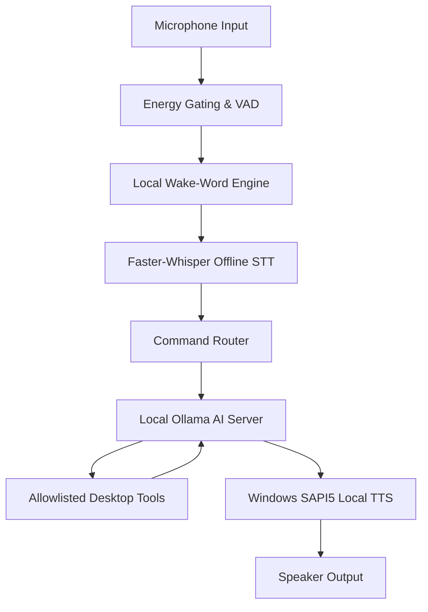

# EAGLE — Offline AI & Local Operation Setup Guide

This guide explains how to configure and run **EAGLE** (Enhanced Autonomous General-purpose Local Executive) completely offline on Windows 11 without paid AI subscriptions, cloud API keys, or an active internet connection.

---

## 1. Overview of Offline Architecture

EAGLE achieves 100% offline capability by chaining local system components:



### Complete Offline Guarantee:
- **No Cloud LLM Calls**: AI reasoning runs on your local GPU/CPU via **Ollama**.
- **No Paid Subscriptions**: Powered by open-weights models (`qwen2.5:3b`, `llama3.2`, etc.).
- **No Cloud STT / TTS**: Speech recognition runs locally using **faster-whisper** (`int8` quantized); speech synthesis uses Windows native **SAPI5**.
- **Strict Offline Policy**: When `offline_mode: true` is enabled, all outgoing cloud AI requests (OpenAI, Groq, Anthropic, Gemini) are blocked by the security layer with `OfflinePolicyViolationError`.

---

## 2. System Hardware Requirements for Offline Operation

| Component | Minimum | Recommended |
|---|---|---|
| **OS** | Windows 10/11 (64-bit) | Windows 11 (64-bit) |
| **CPU** | Quad-core Intel Core i5 / AMD Ryzen 5 | 8-core Intel Core i7 / AMD Ryzen 7 |
| **RAM** | 8 GB System Memory | 16 GB+ System Memory |
| **GPU** | Integrated Intel/AMD Graphics | NVIDIA RTX GPU with CUDA (4 GB+ VRAM) |
| **Storage** | 4 GB free space | 10 GB+ SSD space |
| **Audio** | Working microphone & speakers | Noise-cancelling headset or USB mic |

---

## 3. Step 1: Installing & Configuring Ollama

Ollama is an open-source, local AI model runner that serves large language models through a fast, lightweight local REST API (`http://localhost:11434`).

### 1. Download & Install Ollama
1. Download the Windows installer from [Ollama.com](https://ollama.com/download/windows).
2. Run `OllamaSetup.exe` and complete the installation wizard.
3. Ollama will start automatically and run in your Windows system tray.

### 2. Verify Ollama Installation & Service
Open PowerShell and verify:
```powershell
# Verify Ollama is in your PATH
ollama --version

# Verify the local Ollama server is responding
curl.exe http://localhost:11434/api/version
```
Expected output: `{"version":"0.5.x"}`.

### 3. Pull Recommended Offline Model (`qwen2.5:3b`)
EAGLE recommends `qwen2.5:3b` for fast, lightweight local reasoning and robust tool-calling support:
```powershell
ollama pull qwen2.5:3b
```
*(Optional alternatives: `ollama pull llama3.2` or `ollama pull qwen2.5:7b` for higher reasoning capability).*

### 4. Verify Installed Models
```powershell
ollama list
```
Ensure `qwen2.5:3b` appears in the list.

---

## 4. Step 2: Local Speech Recognition (Faster-Whisper)

EAGLE uses **faster-whisper** (CTranslate2) for offline speech recognition.

### Model Storage Location:
- **Windows**: `%LOCALAPPDATA%\EAGLE\models\whisper\`
- **Source / Portable**: `~/.cache/eagle/models/whisper/`

### Pre-downloading Whisper Models for Air-Gapped Use:
To prepare a machine with no internet connection, pre-download the model weights while connected:
```powershell
python -c "from faster_whisper import WhisperModel; from eagle.core.paths import get_models_dir; WhisperModel('base', download_root=str(get_models_dir() / 'whisper'))"
```
Once downloaded, the model will run completely offline. In strict offline mode, EAGLE enforces `local_files_only=True` to guarantee no accidental network calls are attempted.

---

## 5. Step 3: Local Text-to-Speech (Windows SAPI5)

EAGLE utilizes Microsoft Windows native Speech API (**SAPI5**) via `pyttsx3`.
- **Zero internet required**: Voice synthesis operates 100% locally.
- **Voice Selection**: Choose from installed Windows voices (e.g. *Microsoft David*, *Microsoft Zira*, *Microsoft Mark*).
- **Customization**: Speaking rate (WPM) and volume can be configured in the GUI Settings dialog.

To install additional voices on Windows 11:
1. Open Windows **Settings** (`Win + I`).
2. Go to **Time & language -> Speech**.
3. Under **Manage voices**, click **Add voices** to install additional languages or accents.

---

## 6. Step 4: Configuring EAGLE for Offline Mode

### Method A: Graphical Settings Dialog
1. Launch EAGLE (`EAGLE.exe` or `python -m eagle.main`).
2. Click the **⚙️ Settings** button in the header bar.
3. Open the **🧠 AI Reasoning** tab:
   - Set **AI Provider** to `ollama`.
   - Set **Model Name** to `qwen2.5:3b`.
   - Set **Base URL** to `http://localhost:11434`.
   - Check the box: **Strict Offline Mode (prohibit all external cloud calls)**.
4. Click **Save Settings**.
5. The sidebar status panel will immediately display:
   ```text
   AI: OLLAMA (qwen2.5:3b)
   🔒 Strict Offline Mode
   ```

### Method B: Persistent Configuration File (`config.json`)
Edit `%APPDATA%\EAGLE\config.json`:
```json
{
  "version": "0.1.0",
  "app_name": "EAGLE",
  "log_level": "INFO",
  "ai": {
    "provider": "ollama",
    "model_name": "qwen2.5:3b",
    "base_url": "http://localhost:11434",
    "offline_mode": true,
    "timeout_seconds": 60.0
  },
  "audio": {
    "wake_word_enabled": true,
    "wake_word_phrase": "hey eagle",
    "stt_model_size": "base",
    "tts_voice": "default"
  }
}
```

---

## 7. Testing & Verifying Offline Operation

### 1. Disconnect Network (Simulated or Real)
Disable Wi-Fi or unplug Ethernet:
```powershell
# PowerShell test verification command
pytest tests/integration/test_offline_pipeline.py -v
```

### 2. Spoken Voice Interaction Test
1. Say: **"Hey Eagle"** (or click the microphone indicator in the header).
2. The visualizer glows cyan, indicating active capture.
3. Speak your command:
   - *"Eagle, what is the system telemetry?"*
   - *"Eagle, open notepad."*
   - *"Eagle, what files are in Documents?"*
   - *"Eagle, what is 125 divided by 5?"*
4. EAGLE processes the query via local Ollama, executes allowlisted desktop tools, and vocalizes the result via SAPI5 without sending a single byte outside your machine.

---

## 8. Troubleshooting & Frequently Asked Questions

### Q: Ollama server is reported as "Offline" or "Not Reachable"
- Ensure Ollama is running. Look for the llama icon in your Windows notification tray.
- If Ollama is not started, launch it from the Start Menu or run:
  ```powershell
  ollama serve
  ```
- Verify `http://localhost:11434` in your browser.

### Q: "Model 'qwen2.5:3b' is not installed in Ollama"
- Open PowerShell and pull the model:
  ```powershell
  ollama pull qwen2.5:3b
  ```

### Q: Speech recognition is slow on CPU
- By default, `faster-whisper` uses CPU with `int8` quantization.
- For maximum speed on NVIDIA systems, ensure CUDA drivers are installed.
- Alternatively, use the `"tiny"` model size for near-instant transcription on older CPUs:
  Set `"stt_model_size": "tiny"` in Settings.

### Q: Cloud AI requests are blocked with `OfflinePolicyViolationError`
- This is intentional security behavior. When `offline_mode: true` is set, EAGLE strictly prevents accidental transmission of audio transcripts or queries to OpenAI, Groq, or other cloud APIs.
- To use cloud providers, switch `offline_mode` to `false` in Settings.

